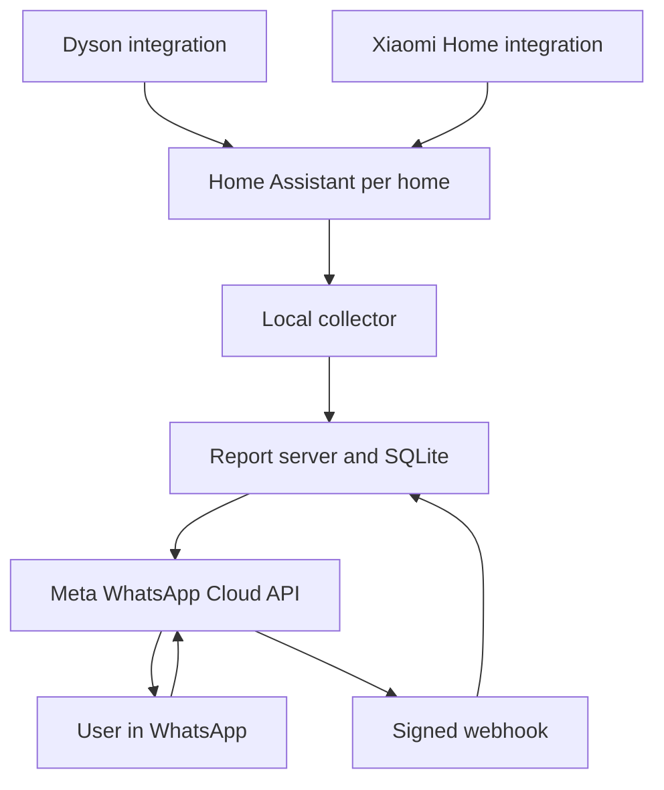

# Air Care — Telegram first, WhatsApp future

**Start here: [Project aim, completed work, and remaining tasks](docs/PROJECT_STATUS.md).**

Current direction: a **free**, phone-based service for elderly users, with no extra home hardware or router changes. Telegram is the approved first channel. WhatsApp remains a future researched option. The repository name is retained for continuity.

- [Telegram/Cloudflare prototype and setup](cloudflare/README.md)
- [Future free WhatsApp research](docs/WHATSAPP_FUTURE.md)
- **Progress:** 28 Python tests passed; 15 new serverless tests passed locally.
- **Deployment:** none. No paid service has been created.
- **Main blocker:** a verified, free vendor-cloud connector for the actual Dyson and Xiaomi units. The Telegram Worker accepts readings but does not obtain them from vendor accounts itself.

The sections below describe the original Python/WhatsApp prototype and its historical deployment proposals. They do not mean that a live free service is ready.

**Current requirement: free only. Deployment is blocked.** The paid Render manifest has been removed. The current SQLite and in-process scheduler must not be deployed on Render Free as a reliable service. Read [Free-only constraints](docs/FREE_ONLY.md) before using the earlier deployment instructions. No cloud service or live messaging has been enabled.

**Cloud hosting design:** The no-home-hardware path is documented in [Cloud setup](docs/CLOUD_SETUP.md). Its paid deployment proposal is now withdrawn. The cloud poller reads a separately commissioned cloud integration host. **Not deployed yet.** 28 local tests passed. Vendor login and HJ10 cloud readings still need verification. The local gateway deployment below remains a legacy option, not a requirement of the proposed cloud mode.

One scheduled WhatsApp report for household air readings, grouped by **home → room → device**. Users need only WhatsApp after a helper installs and connects the service.

**Status:** implemented and locally tested pilot. Not deployed. Physical device access, Meta credentials, approved templates, real WhatsApp delivery, and HJ10 compatibility have not been tested. Do not describe this build as a working connection to the owner's appliances yet.

## What it does

- Collects mapped Home Assistant readings through a read-only REST adapter.
- Supports cloud-source polling from the report server. The legacy local mode uses an outbound HTTPS collector at each home.
- Supports PM2.5, relative humidity, temperature, filter remaining, and tank-full status **where an integration exposes them**.
- Sends one consolidated message per schedule, not one message per sensor change.
- Accepts daily times, 2–24 hour intervals, quiet hours, status requests, home/room selection, and stop/start commands.
- Keeps phone-to-home permissions separate from user-visible home selection.
- Requires `START` consent before scheduled delivery. Adding a phone does not subscribe it.
- Marks readings over 15 minutes old. Preserves source timestamps and never substitutes zero for unavailable data.
- Uses the official WhatsApp Cloud API. Uses an approved template outside the service window, with a conservative 23-hour cutoff.
- Stores schedules and a delivery queue in SQLite. Skips missed slots after outages and does not automatically retry uncertain sends.
- Has no LLM, subscriptions imposed by this code, device control, or scraping of WhatsApp Web. Hosting and Meta usage can cost money.

## Architecture



Device accounts remain with Home Assistant. The collector holds a Home Assistant token and a token for one home. The central service holds recipient numbers, access lists, the latest mapped readings, and delivery records. Meta receives report content and recipient numbers. This is not an entirely local or end-to-end private sensor system.

## Device readiness

| Device | Proposed bridge | Readiness |
|---|---|---|
| Dyson HushJet Compact HJ10 | Home Assistant Dyson community integration | **Blocked pending exact-model verification.** HJ10 support PR #321 is open in the source checked on 11 Oct 2026. No claim of working support. |
| Xiaomi Smart Air Purifier 4 Lite | Official Xiaomi Home integration | Integration path exists. Confirm regional device identifier and exposed entities on the actual unit. |
| Xiaomi Smart Dehumidifier Lite | Official Xiaomi Home integration | `xiaomi.derh.lite` appears in upstream work. Confirm temperature units, humidity, and tank-full entity on the actual unit. |

The phrase “Air Purifier 4 Lite 2” is treated as two 4 Lite units in the sample mapping. Confirm the product label before setup. Sample entity names are placeholders; they are not discovered devices. Two HJ10 units are also illustrative because the precise count was not supplied. Unsupported HJ10 data stays unavailable until an integration is verified. Do not install an unreviewed fork merely to satisfy a demonstration.

## Run the tests

Requires Python 3.12+ and system IANA time-zone data. No third-party Python dependencies.

```sh
python -m unittest discover -s tests -v
```

The test suite makes only loopback HTTP requests. It sends no real WhatsApp messages.

## Documents

- [Cloud setup](docs/CLOUD_SETUP.md): the preferred path for phone-only users with no extra home hardware.
- [User instructions](docs/USER_GUIDE.md): short WhatsApp-only procedures, written using ASD-STE100 principles.
- [Installer instructions](docs/INSTALLER_GUIDE.md): device mapping, tokens, Meta setup, and activation.
- [Design and operating limits](docs/DESIGN.md).
- [Test evidence and acceptance checklist](docs/TEST_REPORT.md).
- [Source references](docs/SOURCES.md).

**Language note:** the instructions use short sentences, imperative steps, and consistent technical terms. They have not been checked against the complete ASD-STE100 controlled dictionary or certified for full compliance.

## Quick start for a technical helper

1. Complete the installer guide before sending live messages.
2. Create `data/` and copy `examples/server.env.example` to `.env`.
3. Add real values to `.env`. Keep it out of Git.
4. Add homes and allowed users with `python -m aircare.admin`.
5. Start the server behind HTTPS with `docker compose up -d --build`.
6. Run one collector inside each home network.
7. Ask an enrolled user to send `START` from WhatsApp.

The elderly user does not install Home Assistant, handle tokens, use GitHub, or log into a device account. A helper must complete these tasks once. A WhatsApp chat alone cannot pair these appliances to Wi-Fi or authorise their accounts.
